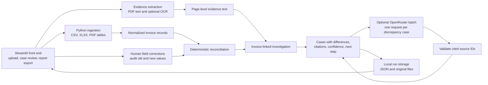

# ITC Discrepancy Investigator

A simple Python website for investigating differences between a purchase register and GSTR-2B. It links discrepancies to uploaded evidence, checks a supplied later-period GSTR-2B, lets a person correct extracted fields, and optionally sends every discrepancy case to NVIDIA Nemotron 3 Ultra through OpenRouter. It does not determine ITC eligibility or submit GST returns.

The four-page project brief is available as a [PDF preview](report/ITC_Discrepancy_Investigation_Report.pdf).

## Architecture



The front end is `app.py` (Streamlit). The backend is the `backend/` Python package:

| Module | Responsibility |
| --- | --- |
| `ingest.py` | Read registers, normalize headers/dates/amounts, extract supporting text with page references. |
| `engine.py` | Match by supplier GSTIN and normalized invoice number; classify missing entries, differences, duplicate keys, formatting variations, and a unique possible GSTIN mismatch; examine linked notes and later statements. |
| `ai.py` | Send each discrepancy case's source fields and short excerpts to the single configured OpenRouter model; validate JSON and source IDs before saving feedback. |
| `service.py` | Process all cases missing AI feedback after the user chooses OpenRouter mode; save each result or error separately. |
| `store.py` | Save runs, original uploads, results, human corrections, review state, and optional AI analyses under `data/runs/`. |
| `report.py` | Export summary text, CSV, and Excel reports with findings, human-edited status, AI suggestions, and a correction history sheet. |

The investigation rules are deliberately conservative. A linked note is a **possible** explanation until its amounts and reporting period are checked. A matching later GSTR-2B entry supports later reporting, but a human still decides what to do. The optional LLM result is shown separately from the deterministic finding and is never treated as a final tax decision.

## Install

Python 3.10 or newer is required. From this directory:

```bash
python3 -m venv .venv
source .venv/bin/activate
python -m pip install --upgrade pip
python -m pip install -r requirements.txt
```

For scanned PDFs or image evidence, install the **Tesseract** system program as well. On Ubuntu/Debian:

```bash
sudo apt-get update
sudo apt-get install tesseract-ocr
```

On macOS: `brew install tesseract`. Text-based PDFs and CSV/XLSX registers do not require the Tesseract program.

## Run the website

```bash
source .venv/bin/activate
streamlit run app.py
```

Open the local URL printed by Streamlit, usually `http://localhost:8501`. Stop the server with `Ctrl+C`.

## Optional OpenRouter setup

You need your own OpenRouter API key for AI analysis. **Do not send the key in chat or commit it to Git.** Copy `.env.example` to `.env`, paste your key after `OPENROUTER_API_KEY=`, and restart Streamlit:

```bash
cp .env.example .env
```

The `.env` file is ignored by Git. You can create a key from the [OpenRouter dashboard](https://openrouter.ai/settings/keys). The only configured model is `nvidia/nemotron-3-ultra-550b-a55b:free` (with a hyphen between `550b` and `a55b`). Choose **OpenRouter** as the investigation mode and confirm that the case data is synthetic or non-confidential. The app then sends all discrepancy cases automatically, one request per case. For an existing run or after a correction, the single **Analyze all pending cases with OpenRouter** button processes any cases still missing feedback. **Local only** mode makes no OpenRouter requests.

The free model is subject to availability and [free-tier rate limits](https://openrouter.ai/collections/free-models). A large run may hit the daily limit; completed cases are saved, and pending cases can be retried later. The [Nemotron free endpoint](https://openrouter.ai/nvidia/nemotron-3-ultra-550b-a55b%3Afree) says not to upload confidential or personal information. Do not send actual taxpayer data to the free endpoint without reviewing the provider terms and your organization's data policy. The integration sends each case's extracted fields and short cited excerpts, not the original uploaded files. There is no API-key-free live model test in this repository; mocked API tests cover request and response handling.

## Try the sample investigation

Upload these files from `sample-data/`:

1. `purchase_register_oct_2026.csv` as **Purchase register**.
2. `gstr2b_oct_2026.csv` as **GSTR-2B for the same period**.
3. `gstr2b_nov_2026_optional_cross_period.csv` as **Later-period GSTR-2B**.

Click **Investigate discrepancies**. The sample produces one clean match and nine investigation cases covering value/tax differences, missing records, a duplicate row, an invoice-number formatting variation, and a GSTIN mismatch. `sample-data/test_cases_and_expected_results.csv` explains all ten scenarios. The duplicate `INV-005` purchase row is intentional test data; do not delete it. The XLSX workbook contains the same dataset in sheets as an alternative format for testing.

Use **Verify / correct** to select any extracted record, change its fields, and save. The record is then labeled **Human edited**; its prior values and correction time are retained. Reconciliation reruns immediately. Correcting a value can resolve a case or change its category. Review statuses and AI analyses for affected cases reset so they cannot be mistaken for reviews of the new values.

Use **Findings and reports** to review each case and its separate OpenRouter feedback. The summary and download buttons are at the end of that tab. The Excel file includes separate **Human corrections** and **AI analyses** sheets.

## Input format

The two primary registers accept CSV, XLSX/XLSM, or a text-based PDF that contains a recognizable table. Each table needs columns for supplier GSTIN, invoice number, and taxable value. Optional columns are supplier name, invoice date, IGST, CGST, and SGST. Common names such as `GSTIN of supplier`, `Invoice number`, `Taxable value`, and `Integrated tax` are recognized. The sample CSVs show the safest format. Amounts must be numeric, with optional commas or `₹`; dates should be ISO (`YYYY-MM-DD`) or day-first (`DD/MM/YYYY`).

Supporting documents accept PDF, PNG, JPG, TIFF, CSV, and XLSX. Label each uploaded document as an invoice, credit note, debit note, amendment, email, or other. For PDFs, extracted text is kept with its page number. OCR is attempted on scanned PDF pages and images if Tesseract is installed. The app links a document when it contains the normalized invoice number and, for most document types, the supplier GSTIN. Uploads are limited to 15 MB each.

## Review and data handling

Every case starts as **Needs review**. An accountant can mark it **Reviewed** or **Needs follow-up** and add a note. The reports include the latest review state, human edit markers, and optional AI outputs. Original uploads and JSON results remain on the local computer in `data/runs/<run-id>/`; deleting that folder removes the run. This is a local prototype, so it has no login, role-based access control, encryption at rest, or shared-team concurrency safeguards. Keep it on a trusted machine and avoid exposing Streamlit publicly with sensitive tax documents.

## Current limits and next architecture steps

- Scanned primary registers are not converted to invoice tables. Export purchase register and GSTR-2B as CSV/XLSX for reliable matching. OCR is used for supporting documents only.
- Matching uses exact GSTIN plus normalized invoice number; formatting differences are flagged for review. It does not merge ambiguous or fuzzy invoice numbers.
- A mention in a note or email is not proof of the cause. The app does not calculate GST eligibility, tax rates, filing periods, or accounting adjustments.
- The AI response is checked for JSON shape and valid source IDs, but software cannot prove that every sentence is supported by its citations. Accountants must review the original files.
- For production: add authenticated users and client separation; encrypted document storage; a database with durable audit history; background OCR jobs; independent validation of AI claims; and PDF reporting.

## Tests

```bash
python -m unittest discover -s tests -v
```
